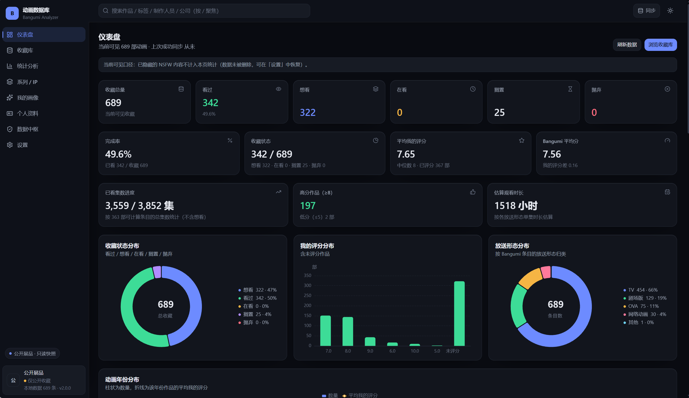
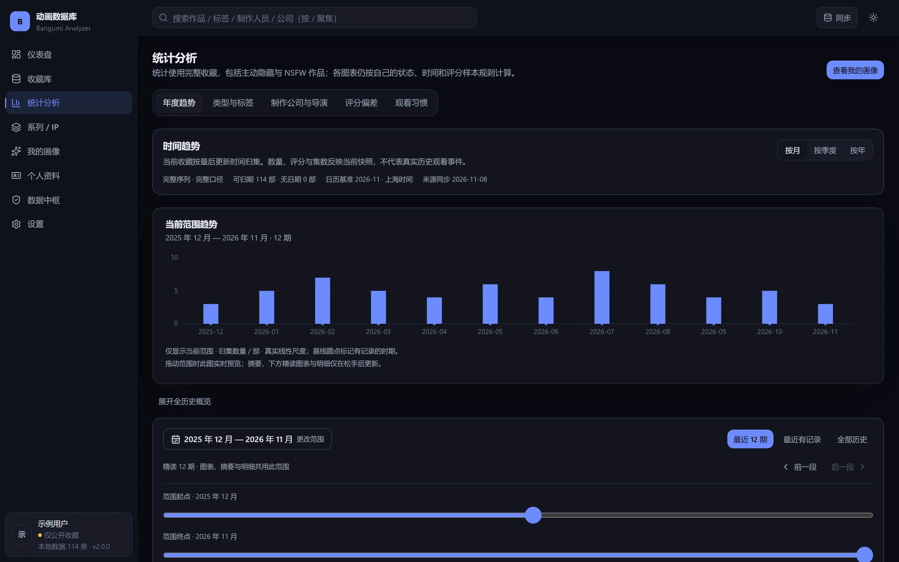
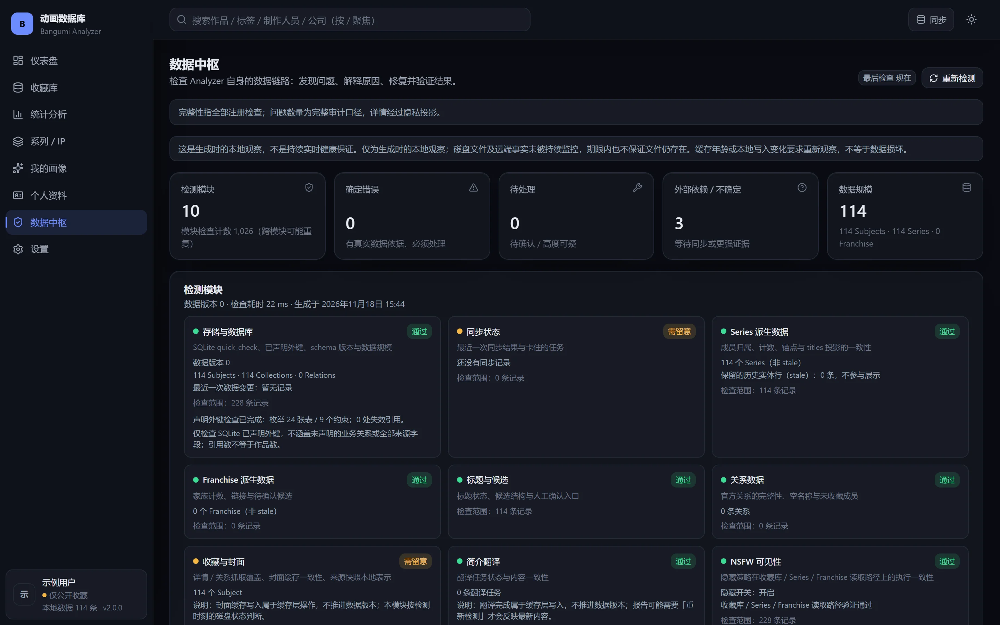

# Bangumi Analyzer

**本地优先的个人 Bangumi 动画数据同步、统计分析与 Windows 桌面管理工具**

把你在 Bangumi 的看过、想看、评分、标签与系列关系同步到自己的电脑本地，离线检索、回看时间趋势、梳理系列与家族作品，并由桌面伴侣 **Companion 与小番** 陪你完成一键安装、备份与日常管理。

  <a href="https://github.com/youshengyueye523-code/bangumi-analyzer-app/releases/tag/v2.0.0"><strong>⬇️ 下载 Windows 正式版 v2.0.0</strong></a>
  &nbsp;|&nbsp;
  <a href="https://youshengyueye523-code.github.io/bangumi-analyzer-site/"><strong>🌐 产品官网</strong></a>
  &nbsp;|&nbsp;
  <a href="https://bangumi-analyzer-demo.vercel.app"><strong>✨ 在线 Demo</strong></a>
  &nbsp;|&nbsp;
  <a href="./CHANGELOG.md">更新日志</a>
  &nbsp;|&nbsp;
  <a href="./CONTRIBUTING.md">开发者指南</a>

  <code>Windows 10/11 x64</code>
  &nbsp;·&nbsp;
  <code>Analyzer v2.0.0 (r5)</code>
  &nbsp;·&nbsp;
  <code>Companion v2.0.0</code>
  &nbsp;·&nbsp;
  <code>MIT + CC BY 4.0</code>

 

---

## 1. 这是什么软件？

**Bangumi Analyzer** 是一款面向 Bangumi (bgm.tv) 动画爱好者的**本地优先**数据整理与分析工具：

- **真正拥有自己的收藏数据**：将公开收藏（或凭个人 Token 同步私有收藏）写入本机 SQLite 数据库，离线秒开检索，不依赖任何第三方托管服务器。
- **把零散条目理成长期脉络**：自动按官方关联整理 **Series（系列）** 与 **Franchise（家族）**，用可追溯的数据呈现你的评分偏好、时间趋势、制作公司与监督分布。
- **面向普通用户的 Windows 桌面体验**：搭配 **Bangumi Analyzer Companion** 图形安装器与桌面伴侣，内置独立 Node 24 运行时与小番 Live2D，无需另装开发环境即可完成安装、主题配置、同步、备份与一键访问。

---

## 2. 真实界面预览

<table>
  <tr>
    <td width="50%" align="center">
      <strong>Companion 桌面伴侣与小番（Live2D）</strong>  
      
    </td>
    <td width="50%" align="center">
      <strong>Analyzer 时间趋势分析</strong>  
      
    </td>
  </tr>
  <tr>
    <td width="50%" align="center">
      <strong>Series / IP 实体证据与评分画像</strong>  
      
    </td>
    <td width="50%" align="center">
      <strong>数据中枢自检与诊断</strong>  
      
    </td>
  </tr>
</table>

> 以上均为程序真实运行截图，使用公开安全示例数据；数据中枢与时间趋势截图来自 Analyzer v2.0.0 示例库。

---

## 3. 核心功能

- **一键同步与离线收藏库**：同步 Bangumi 动画收藏、评分、集数进度、标签与封面缓存至本机 SQLite，支持快速搜索、筛选与状态管理。
- **时间趋势与多维统计**：按年 / 季度 / 月浏览历史趋势，查看评分分布、评分偏差、常看类型标签、制作公司与导演画像。
- **Series / Franchise 实体分析**：基于 Bangumi 官方作品关联自动归并系列与跨系列家族；自动确定稳定系列标题并保留真正歧义供你复核，支持随时手动修改与人工锁定。
- **数据中枢与可信诊断**：内置 10 项数据链路检测模块（数据库完整性、同步状态、系列派生、标题候选、关系与封面缓存等），提供先预览再修复的可验证治理体验。
- **桌面伴侣 Companion**：集成独立运行时、老用户重连、六个网页端直达快捷入口、跨端口持久化网页端主题设置、就绪单次自动打开网页端、一键备份恢复、完整性自检及小番陪伴舞台。

---

## 4. 下载 Windows 正式版 (`v2.0.0`)

当前公开最新版本为 **`v2.0.0`（正式版）**——包含 **Companion `v2.0.0`** 与 **Bangumi Analyzer `v2.0.0 r5`**（Series Engine v3），免装 Node.js、Git 或 Live2D SDK，开箱即用。过往 RC 预发行版本（`v2.0.0-rc3`、`v2.0.0-rc4`、`v2.0.0-rc5`）保留在 Releases 历史归档中。

> ⚠️ **请勿下载 GitHub 自动生成的 `Source code (zip)` 作为安装包**——请使用下方预编译的 Windows 发行文件。

| 下载入口 | 形态与大小 | 适用人群 |
| --- | --- | --- |
| **[⬇️ 下载图形安装版 (.exe)](https://github.com/youshengyueye523-code/bangumi-analyzer-app/releases/download/v2.0.0/Bangumi-Analyzer-Companion-Setup-2.0.0-win-x64.exe)** | 安装器（推荐）· 199.1 MB | 绝大多数 Windows 用户；图形向导、桌面/开始菜单快捷方式、保留数据卸载器（已含 Analyzer r5 与小番 Live2D） |
| **[📦 下载绿色便携版 (.zip)](https://github.com/youshengyueye523-code/bangumi-analyzer-app/releases/download/v2.0.0/Bangumi-Analyzer-Companion-Portable-2.0.0-win-x64.zip)** | 完整便携包 · 199.0 MB | 解压即用、配置保存在 `companion-data/` 方便整目录迁移（已含 Analyzer r5 与小番 Live2D） |
| **[🧩 下载 Analyzer 独立运行包 (.zip)](https://github.com/youshengyueye523-code/bangumi-analyzer-app/releases/download/v2.0.0/Bangumi-Analyzer-2.0.0-windows-x64-r5.zip)** | 纯 Analyzer 离线核 · 39.2 MB | 仅需独立网页端运行时或用于 Companion「维护与诊断 → 安全更新」本地升级 |
| **[🔍 查看 Release v2.0.0](https://github.com/youshengyueye523-code/bangumi-analyzer-app/releases/tag/v2.0.0)** | 发布说明与 `SHA256SUMS.txt` | 核对文件完整性、阅读完整更新日志与已知限制 |

### 系统要求与文件校验

- **系统要求**：Windows 10 / 11（64 位 x64），约 800 MB 可用磁盘空间。无需预先安装 Node.js、Python 或单独下载 Live2D Core。
- **核对 SHA-256**（可在 PowerShell 中运行 `Get-FileHash <文件名> -Algorithm SHA256` 并与 [SHA256SUMS.txt](https://github.com/youshengyueye523-code/bangumi-analyzer-app/releases/download/v2.0.0/SHA256SUMS.txt) 比对）：
  - 安装版 `.exe`：`6e8cc079234e2da9fc0143b2530977e8e215e949ee89375993e1ae0f363a2a1c`
  - 便携版 `.zip`：`24950a5ab67d673bf0451e5f0914709592ca69af20f5e7bd5b9f004255b70387`
  - 独立离线核心 `r5.zip`：`b227f6632c9060642444e550e2bc3f2256450bad2e3c4b0420d00e31ed77bcfa`
- **关于 Windows SmartScreen 提示**：本个人开源发行版目前**尚未购买商业 Authenticode 代码签名证书**，首次运行时 Windows SmartScreen 可能会弹出「Windows 已保护你的电脑 / 未知发布者」提示。请务必先核对上方 SHA-256 摘要确认文件来自官方 GitHub Release，再按系统提示选择「更多信息 → 仍要运行」；**切勿关闭 Windows Defender 或全局禁用系统防护**。

---

## 5. 三步快速开始

1. **下载并启动**：运行图形安装器完成安装（或解压便携版完整文件夹后双击 `Bangumi-Analyzer-Companion.exe`）。
2. **完成首次引导（或连接已有安装）**：
   - 新用户：选择一个独立的本地数据目录（请避开 `Program Files` 和 OneDrive 同步目录），输入你的 Bangumi 用户名或数字 UID（若需同步私密收藏可填入个人 Access Token，也可先跳过稍后再配）。
   - 老用户：在欢迎页点击「**我有旧版安装，直接重连**」，选中原 Analyzer 安装目录（如 `C:\BangumiAnalyzer`）即可直接接回原有数据库与设置。
3. **开始探索**：初始化完成后点击「**打开 Analyzer 网页端**」，或直接在 Companion 首页使用六个快捷入口卡片直达对应分析页面；也可在「启动与偏好」中开启自启动、就绪自动打开网页端及网页端深浅主题。

---

## 6. Companion 与站娘「小番」

**Bangumi Analyzer Companion** 是专为普通 Windows 用户打造的桌面伴侣：

- **六个直达快捷入口**：首页「档案与快捷入口」提供 **仪表盘** (`/`)、**收藏库** (`/library`)、**统计分析** (`/analysis`)、**系列 / IP** (`/series`)、**我的画像** (`/profile`) 与 **数据中枢** (`/diagnostics`) 六张直达卡片，自动适配每次启动分配的 `127.0.0.1` 随机端口；服务未就绪时会给出明确提示，不静默失败。
- **网页端主题持久化与自动启动打开**：可在「启动与偏好」设置 **Analyzer 网页端主题**（深色 / 浅色 / 跟随系统），写入本机 `data/config.json` 与网页端双向同步、跨端口重启不丢失，并与 Companion 自身外观主题相互独立；开启「自动启动 Analyzer」与「服务启动后自动打开网页端」后，冷启动或手动重启服务仅在就绪后打开一次浏览器首页。
- **省心管理、备份与安全更新**：自动隔离端口、一键安全停机、关闭窗口前确保 SQLite 安全落盘、时间戳数据库备份、脱敏诊断导出、本地更新包验证（失败自动回滚）及默认保留 `data/` 的安全卸载。
- **小番（Xiaofan）Live2D 舞台**：Windows 环境默认启用高兼容 ANGLE D3D11 渲染路径并支持 Windows 11 高 DPI 窗口形态同步（最小化自动暂停、恢复自动同步渲染与恢复能力），支持无边框全屏（`F11` / `Esc`）、`auto / 30 / 60 / 120 FPS` 策略、8 种业务联动状态与 7 种独立短暂随机互动；异常时自动安全降级至 2D 舞台。

---

## 7. 先看再装：在线只读 Demo

不想立刻下载？可以先访问独立部署的在线只读展品体验界面与分析功能：

👉 **[打开 Bangumi Analyzer 在线只读 Demo](https://bangumi-analyzer-demo.vercel.app)**

- **当前快照**：Analyzer `v2.0.0`（Schema 15 只读公开快照），覆盖收藏检索、时间趋势、Series / 家族分析、静态 AI 画像与数据中枢只读诊断。
- **严格隔离**：纯只读展品，不会连接你的电脑，也不会保存访客信息或执行在线同步。

---

## 8. 本地数据、同步与可选 AI 的实际边界

| 维度 | 实际行为与边界 |
| --- | --- |
| **数据存储** | 所有收藏、评分、备注与封面缓存均保存在你选定目录的 `data/bangumi.db` 与 `data/covers/` 中。 |
| **联网同步** | 仅在你主动触发同步时请求 Bangumi API；同步完成后浏览、检索、统计分析完全可离线运行。 |
| **凭据保护** | Bangumi Access Token 与可选 AI API Key 仅保存在本地 Analyzer 的 `data/config.json`，不上传第三方服务器，也不写入 Companion 偏好文件。 |
| **可选 AI 功能** | 默认关闭。仅当你主动配置并触发 AI 画像或简介翻译时，才会将所需分析摘要发送给你指定的兼容接口服务商。 |
| **更新机制** | 当前版本**未开启自动静默联网更新**；可通过内置「维护与诊断」使用本地更新包/清单验证升级（保留 `data/`，失败自动回滚）或前往 GitHub Releases 手动升级。 |

---

## 9. 常见问题 (FAQ)

<strong>Q1：安装版和便携版应该选哪一个？普通用户需要单独下载 Live2D Core 吗？</strong>

- **普通用户不需要单独下载 Live2D Core**：正式编译发布的 Windows 安装版（`.exe`）和绿色便携版（`.zip`）均已内置完整的 Analyzer 核心、Node 24 运行时与小番 Live2D 运行库，开箱即用。
- **安装版（推荐）**：提供图形安装向导、桌面/开始菜单快捷方式以及系统卸载入口；**便携版**：完整目录解压即用，Companion 配置保存在便携目录 `companion-data/` 下，方便移动或备份。（仅当开发者从公开源码仓库自行编译时，才需要按 `CONTRIBUTING.md` 可选获取 Core 或以 2D 占位运行。）

<strong>Q2：如何在 Companion 或网页端设置 Analyzer 网页端主题？切换端口后会重置吗？</strong>

不会重置。Companion 每次启动 Analyzer 时会监听不同的本机随机端口，因此从 `v2.0.0` 起网页端主题已由浏览器 `localStorage` 升级为持久化保存在你安装目录的 **`data/config.json`** 中，并在页面首屏渲染前注入生效：
- 你可以在 Companion **「启动与偏好 → Analyzer 网页端主题」** 选择 **深色 / 浅色 / 跟随系统**；
- 也可以直接在 Analyzer 网页端右上角主题按钮或 **「设置 → 外观」** 中切换；
- 两处设置保持同步，且 **Companion 桌面窗口自身主题** 与 **Analyzer 网页端主题** 相互独立（新用户未主动修改时默认跟随系统）。

<strong>Q3：如何开启“启动后自动启动并自动打开网页端”？六个快捷入口怎么用？</strong>

- 在 Companion 主页 **「启动与偏好」** 中开启「启动 Companion 时自动启动 Analyzer」与「服务启动后自动打开网页端」后，冷启动或手动启动服务会在 Analyzer 真正就绪后自动在默认浏览器打开首页一次（状态轮询、最小化或恢复窗口不会重复弹标签页；关闭开关后即停止自动打开）。
- 在主页 **「档案与快捷入口」** 中的六个功能卡片（**仪表盘** `/`、**收藏库** `/library`、**统计分析** `/analysis`、**系列 / IP** `/series`、**我的画像** `/profile`、**数据中枢** `/diagnostics`）会直接使用当前运行实例的随机本机端口跳转对应页面；若服务尚未启动，会弹出明确提示而不会静默失效。

<strong>Q4：更新版本或重装、卸载会删掉我的 Bangumi 数据吗？</strong>

默认**不会**。
- **从旧版更新**：可用老 Companion 在「欢迎页 → 我有旧版安装，直接重连」或用新版 Companion「维护与诊断 → 安全更新（选择新版离线核心 `Bangumi-Analyzer-2.0.0-windows-x64-r5.zip`）」原地更新程序文件，系统会先自动备份并完整保留 `data/` 下的 `bangumi.db`、`config.json`、历史备份与 Series/Franchise 人工锁定；若更新后自检失败会自动回滚。
- **卸载**：无论是 Companion「维护与诊断 → 安全卸载」还是 Windows 卸载程序，默认只移除程序文件与快捷方式、完整保留 `data/`；只有主动勾选并二次确认删除数据时才会清理 `data/`。

<strong>Q5：双显卡或高分屏设备上窗口切换或小番 Live2D 出现异常怎么办？</strong>

`v2.0.0` 针对 Windows 10/11 高 DPI 与双显卡（如 Intel 核显 + NVIDIA 独显）默认优先使用更稳定的 **ANGLE D3D11** 兼容后端，并在最大化 / 最小化恢复 / 全屏切换时同步窗口与 Live2D 渲染尺寸。如特定老旧驱动或虚拟显卡环境仍遇 GPU 异常，Companion 会自动安全降级至 2D 占位舞台并提示诊断信息，你也可以在「启动与偏好 → Live2D GPU 兼容模式」切换 `OpenGL / D3D11 / 纯 2D`（重启生效），不影响 Analyzer 本体全部功能。

<strong>Q6：当前正式版有哪些已知的客观限制？</strong>

1. **Windows 安装包暂未购买商业代码签名**：首次运行 `.exe` 时 Windows SmartScreen 可能提示未知发布者；请先对比 `SHA256SUMS.txt` 文件哈希，勿关闭杀毒软件全局防护。
2. **仅验证 Windows 10 / 11 x64**：Windows ARM64、旧版 Windows、macOS/Linux 桌面端暂不在本发行包兼容范围内。
3. **无静默联网自动更新**：出于本地控制与安全边界考虑，升级需通过 GitHub Releases 手动下载或在「维护与诊断」选择本地包更新。

---

## 10. 开源许可、作者与第三方致谢

本项目严格区分不同来源的许可边界，互不混同或重新授权：

- **自主源码（Analyzer & Companion）**：采用 [MIT License](./LICENSE) 开源（Copyright © 2026 `youshengyueye523-code`）。
- **角色模型资产（Pink Sakura 与派生 ArmRig 图集）**：基于 [Ariakage / live2d-agent-kit](https://github.com/Ariakage/live2d-agent-kit) 的 **Pink Sakura**（制作统筹 **Ariakage**），遵循 [CC BY 4.0](https://creativecommons.org/licenses/by/4.0/) 许可。按上游记录保留原始参考图及拆层制作来源，详见 [companion/ATTRIBUTION.md](./companion/ATTRIBUTION.md) 与 [companion/ASSET-LICENSE.md](./companion/ASSET-LICENSE.md)。
- **Live2D Cubism Core for Web（专有运行库）**：`live2dcubismcore.min.js` 属于 Live2D Inc. 专有软件（受 **Live2D Proprietary Software License Agreement** 约束，**非 MIT、非 CC BY 4.0**）。**本公开 Git 源码仓库不包含该专有文件**；编译后的个人免费 Windows 发行包按官方 `RedistributableFiles.txt` 随附该运行库与 `CORE-LICENSE.md`（Companion 严格锁定内置固定角色，不提供外部 `.moc3` 导入）。
- **完整第三方许可清单**：见 [THIRD_PARTY_NOTICES.md](./THIRD_PARTY_NOTICES.md)。

> **非背书声明**：本项目为独立个人开源工具，与 Bangumi (bgm.tv) 官方、Ariakage、OpenAI 或 Live2D Inc. 无任何官方隶属、赞助或背书关系。

---

## 11. 开发者与版本记录入口

想阅读源码、运行测试、查看变更日志或从源码自行构建 Windows 发行包？

- 📋 **[更新日志 (CHANGELOG.md)](./CHANGELOG.md)**
- 📘 **[开发者与构建指南 (CONTRIBUTING.md)](./CONTRIBUTING.md)**
- 🏗️ **[系统架构说明 (docs/architecture.md)](./docs/architecture.md)**
- 🔌 **[Bangumi API 同步说明 (docs/bangumi-api.md)](./docs/bangumi-api.md)**
- 📈 **[时间趋势设计说明 (docs/timeline-trends.md)](./docs/timeline-trends.md)**
- 📦 **[Analyzer 分发构建说明 (docs/distribution/BUILD.md)](./docs/distribution/BUILD.md)**
- 🌐 **[产品官网独立仓库 (bangumi-analyzer-site)](https://github.com/youshengyueye523-code/bangumi-analyzer-site)**
