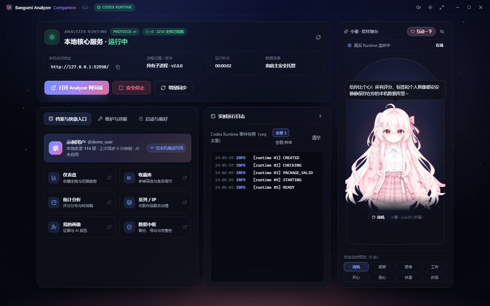
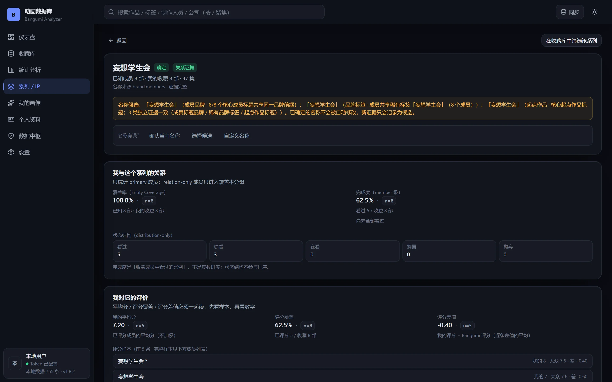

# Bangumi Analyzer

**本地优先的个人 Bangumi 动画数据同步、统计分析与 Windows 桌面管理工具**

把你在 Bangumi 的看过、想看、评分、标签与系列关系同步到自己的电脑本地，离线检索、回看时间趋势、梳理系列与家族作品，并由桌面伴侣 **Companion 与小番** 陪你完成一键安装、备份与日常管理。

  <a href="https://github.com/youshengyueye523-code/bangumi-analyzer-app/releases/tag/v2.0.0-rc4"><strong>⬇️ 下载 Windows 版</strong></a>
  &nbsp;|&nbsp;
  <a href="https://youshengyueye523-code.github.io/bangumi-analyzer-site/"><strong>🌐 产品官网</strong></a>
  &nbsp;|&nbsp;
  <a href="https://bangumi-analyzer-demo.vercel.app"><strong>✨ 在线 Demo</strong></a>
  &nbsp;|&nbsp;
  <a href="./CONTRIBUTING.md">开发者指南</a>

  <code>Windows 10/11 x64</code>
  &nbsp;·&nbsp;
  <code>Analyzer v2.0.0 (r3)</code>
  &nbsp;·&nbsp;
  <code>Companion v2.0.0-rc4</code>
  &nbsp;·&nbsp;
  <code>MIT + CC BY 4.0</code>

 

---

## 1. 这是什么软件？

**Bangumi Analyzer** 是一款面向 Bangumi (bgm.tv) 动画爱好者的**本地优先**数据整理与分析工具：

- **真正拥有自己的收藏数据**：将公开收藏（或凭个人 Token 同步私有收藏）写入本机 SQLite 数据库，离线秒开检索，不依赖任何第三方托管服务器。
- **把零散条目理成长期脉络**：自动按官方关联整理 **Series（系列）** 与 **Franchise（家族）**，用可追溯的数据呈现你的评分偏好、时间趋势、制作公司与监督分布。
- **面向普通用户的 Windows 桌面体验**：搭配 **Bangumi Analyzer Companion** 图形安装器与桌面伴侣，无需安装 Node.js 或敲命令行，打开即可完成设置、同步、备份与一键访问。

---

## 2. 真实界面预览

<table>
  <tr>
    <td width="50%" align="center">
      <strong>Companion 桌面伴侣与小番（Live2D）</strong>  
      
    </td>
    <td width="50%" align="center">
      <strong>Analyzer 时间趋势分析</strong>  
      
    </td>
  </tr>
  <tr>
    <td width="50%" align="center">
      <strong>Series / IP 实体证据与评分画像</strong>  
      
    </td>
    <td width="50%" align="center">
      <strong>数据中枢自检与诊断</strong>  
      
    </td>
  </tr>
</table>

> 以上均为程序真实运行截图，使用公开安全示例数据；数据中枢与时间趋势截图均来自 Analyzer v2.0.0 示例库。

---

## 3. 核心功能

- **一键同步与离线收藏库**：同步 Bangumi 动画收藏、评分、集数进度、标签与封面缓存至本机 SQLite，支持快速搜索、筛选与状态管理。
- **时间趋势与多维统计**：按年 / 季度 / 月浏览历史趋势，查看评分分布、评分偏差、常看类型标签、制作公司与导演画像。
- **Series / Franchise 实体分析**：基于 Bangumi 官方作品关联自动归并系列与跨系列家族；自动确定稳定系列标题并保留真正歧义供你复核，支持随时手动修改与人工锁定。
- **数据中枢与可信诊断**：内置 10 项数据链路检测模块（数据库完整性、同步状态、系列派生、标题候选、关系与封面缓存等），提供先预览再修复的可验证治理体验。
- **桌面伴侣 Companion**：集成独立运行时、图形化首次向导、一键备份恢复、完整性自检、安全退出保护与小番陪伴舞台。

---

## 4. 下载 Windows 版

当前公开版本为 **Pre-release：`v2.0.0-rc4`**（内置 **Bangumi Analyzer `v2.0.0 r3`**，免装 Node.js，开箱即用）。

> ⚠️ **请勿下载 GitHub 自动生成的 `Source code (zip)` 作为安装包**——请使用下方预编译的 Windows 发行文件。

| 下载入口 | 形态与大小 | 适用人群 |
| --- | --- | --- |
| **[⬇️ 下载图形安装版 (.exe)](https://github.com/youshengyueye523-code/bangumi-analyzer-app/releases/download/v2.0.0-rc4/Bangumi-Analyzer-Companion-Setup-2.0.0-rc4-win-x64.exe)** | 安装器（推荐）· 199.1 MB | 绝大多数 Windows 用户；图形向导、桌面/开始菜单快捷方式、保留数据卸载器 |
| **[📦 下载绿色便携版 (.zip)](https://github.com/youshengyueye523-code/bangumi-analyzer-app/releases/download/v2.0.0-rc4/Bangumi-Analyzer-Companion-Portable-2.0.0-rc4-win-x64.zip)** | 完整便携包 · 199.0 MB | 解压即用、配置保存在 `companion-data/` 方便整目录迁移 |
| **[🔍 查看 Release v2.0.0-rc4](https://github.com/youshengyueye523-code/bangumi-analyzer-app/releases/tag/v2.0.0-rc4)** | 发布说明与 `SHA256SUMS.txt` | 核对文件完整性、阅读完整更新日志与已知限制 |

### 系统要求与文件校验

- **系统要求**：Windows 10 / 11（64 位 x64），约 800 MB 可用磁盘空间。无需预先安装 Node.js 或 Python。
- **核对 SHA-256**（可在 PowerShell 中运行 `Get-FileHash <文件名> -Algorithm SHA256` 并与 [SHA256SUMS.txt](https://github.com/youshengyueye523-code/bangumi-analyzer-app/releases/download/v2.0.0-rc4/SHA256SUMS.txt) 比对）：
  - 安装版 `.exe`：`d4115df331ff2c7e4bc8817604fdca9d4a153a6bcac01927bb3b46da80181047`
  - 便携版 `.zip`：`f5e25f10f2544b3cfe8253c83b7a7ebb99eca86435db3515989d70cc9a9e7f59`
- **关于 Windows SmartScreen 提示**：本预发行版目前**尚未进行 Authenticode 商业代码签名**，首次运行时 Windows SmartScreen 可能会提示「未知发布者」。请先核对上方 SHA-256 摘要确认文件来自官方 GitHub Release，再按系统提示决定是否继续运行；**切勿关闭 Windows Defender 或全局禁用系统防护**。

---

## 5. 三步快速开始

1. **下载并启动**：运行图形安装器完成安装（或解压便携版后双击 `Bangumi-Analyzer-Companion.exe`）。
2. **完成首次引导**：选择一个独立的本地数据目录（请避开 `Program Files` 和 OneDrive 同步目录），输入你的 Bangumi 用户名或数字 UID（若需同步私密收藏可填入个人 Access Token，也可先跳过稍后再配）。
3. **开始探索**：初始化完成后点击「打开 Bangumi Analyzer」，即可在浏览器中查看你的仪表盘、收藏库、时间趋势与系列分析。

---

## 6. Companion 与站娘「小番」

**Bangumi Analyzer Companion** 是专为普通 Windows 用户打造的桌面伴侣：

- **省心管理本地服务**：自动隔离监听 `127.0.0.1` 随机本地端口，支持一键启动、安全停机、关闭窗口前确保 SQLite 安全落盘。
- **失败可恢复的首次设置**：若目录被其他实例占用或出现异常，可随时返回上一步或更换目录安全重试，不会永久锁死或破坏已有数据。
- **一键备份、恢复与自检**：内置时间戳数据库快照、恢复前自动二次备份、脱敏诊断报告导出与默认保留 `data/` 的安全卸载。
- **小番（Xiaofan）Live2D 舞台**：无边框全屏适配（`F11` / `Esc`）、`auto / 30 / 60 / 120 FPS` 帧率策略、8 种业务联动状态与 7 种独立短暂随机互动；支持减弱动效、隐身收起及 GPU 异常时自动安全降级至 2D 舞台。

---

## 7. 先看再装：在线只读 Demo

不想立刻下载？可以先访问独立部署的在线只读展品体验界面与分析功能：

👉 **[打开 Bangumi Analyzer 在线只读 Demo](https://bangumi-analyzer-demo.vercel.app)**

- **当前快照**：Analyzer `v2.0.0`（Schema 15 只读公开快照），覆盖收藏检索、时间趋势、Series / 家族分析、静态 AI 画像与数据中枢只读诊断。
- **严格隔离**：纯只读展品，不会连接你的电脑，也不会保存访客信息或执行在线同步。

---

## 8. 本地数据、同步与可选 AI 的实际边界

| 维度 | 实际行为与边界 |
| --- | --- |
| **数据存储** | 所有收藏、评分、备注与封面缓存均保存在你选定目录的 `data/bangumi.db` 与 `data/covers/` 中。 |
| **联网同步** | 仅在你主动触发同步时请求 Bangumi API；同步完成后浏览、检索、统计分析完全可离线运行。 |
| **凭据保护** | Bangumi Access Token 与可选 AI API Key 仅保存在本地 Analyzer 的 `data/config.json`，不上传第三方服务器，也不写入 Companion 偏好文件。 |
| **可选 AI 功能** | 默认关闭。仅当你主动配置并触发 AI 画像或简介翻译时，才会将所需分析摘要发送给你指定的兼容接口服务商。 |
| **更新机制** | 当前版本**未开启自动静默联网更新**；可通过内置的本地更新包/清单校验（支持失败自动回滚）或直接前往 GitHub Releases 手动升级。 |

---

## 9. 常见问题 (FAQ)

<strong>Q1：安装版和便携版应该选哪一个？</strong>

大多数用户推荐**图形安装版（`.exe`）**，安装后会创建桌面与开始菜单快捷方式，并在系统「应用和功能」中提供保留数据的安全卸载器。如果你希望把 Companion 配置放进 U 盘或自定义目录随走随用，可以选择**便携版（`.zip`）**，其配置保存在便携目录的 `companion-data/` 下。两者管理的 Analyzer 数据库均存放在你首次引导选择的目录中。

<strong>Q2：卸载或重装会删掉我的 Bangumi 数据吗？</strong>

默认**不会**。无论是 Companion 的「维护与诊断 → 安全卸载」还是 Windows 卸载程序，默认都会完整保留你所选目录中的 `data/` 数据库与历史备份，只有在你显式勾选并二次确认删除数据时才会清理。

<strong>Q3：双显卡或老旧核显上 Live2D 打不开怎么办？</strong>

Companion 默认采用高兼容 OpenGL 渲染路径；若检测到显卡驱动或 WebGL 不可用，会自动安全回退至 2D 占位舞台并给出诊断提示，你也可以在「设置 → 启动与偏好」中切换「Live2D GPU 兼容模式」或开启低帧率 / 减弱动效选项，不会影响 Analyzer 核心功能。

<strong>Q4：为什么下载页面叫 <code>v2.0.0-rc4</code>（Pre-release）？</strong>

`v2.0.0-rc4` 表示本轮已完成核心契约修复与多轮真实打包回归的**公开预发行候选版本**（内置 Analyzer `v2.0.0 r3`）。由于 Windows 安装包尚未购买商业代码签名证书且未上线自动更新源，我们如实标记为 Pre-release，不伪装成已签名正式版。

---

## 10. 开源许可、作者与第三方致谢

本项目严格区分不同来源的许可边界，互不混同或重新授权：

- **自主源码（Analyzer & Companion）**：采用 [MIT License](./LICENSE) 开源（Copyright © 2026 `youshengyueye523-code`）。
- **角色模型资产（Pink Sakura 与派生 ArmRig 图集）**：基于 [Ariakage / live2d-agent-kit](https://github.com/Ariakage/live2d-agent-kit) 的 **Pink Sakura**（制作统筹 **Ariakage**），遵循 [CC BY 4.0](https://creativecommons.org/licenses/by/4.0/) 许可。按上游记录保留原始参考图及拆层制作来源，详见 [companion/ATTRIBUTION.md](./companion/ATTRIBUTION.md) 与 [companion/ASSET-LICENSE.md](./companion/ASSET-LICENSE.md)。
- **Live2D Cubism Core for Web（专有运行库）**：`live2dcubismcore.min.js` 属于 Live2D Inc. 专有软件（受 **Live2D Proprietary Software License Agreement** 约束，**非 MIT、非 CC BY 4.0**）。**本公开 Git 源码仓库不包含该专有文件**；编译后的个人免费 Windows 发行包按官方 `RedistributableFiles.txt` 随附该运行库与 `CORE-LICENSE.md`（Companion 严格锁定内置固定角色，不提供外部 `.moc3` 导入）。
- **完整第三方许可清单**：见 [THIRD_PARTY_NOTICES.md](./THIRD_PARTY_NOTICES.md)。

> **非背书声明**：本项目为独立个人开源工具，与 Bangumi (bgm.tv) 官方、Ariakage、OpenAI 或 Live2D Inc. 无任何官方隶属、赞助或背书关系。

---

## 11. 开发者入口

想阅读源码、运行测试或从源码自行构建 Windows 发行包（含可选 Live2D Cubism Core 合法接入说明）？

- 📘 **[开发者与构建指南 (CONTRIBUTING.md)](./CONTRIBUTING.md)**
- 🏗️ **[系统架构说明 (docs/architecture.md)](./docs/architecture.md)**
- 🔌 **[Bangumi API 同步说明 (docs/bangumi-api.md)](./docs/bangumi-api.md)**
- 📈 **[时间趋势设计说明 (docs/timeline-trends.md)](./docs/timeline-trends.md)**
- 📦 **[Analyzer 分发构建说明 (docs/distribution/BUILD.md)](./docs/distribution/BUILD.md)**
- 🌐 **[产品官网独立仓库 (bangumi-analyzer-site)](https://github.com/youshengyueye523-code/bangumi-analyzer-site)**
